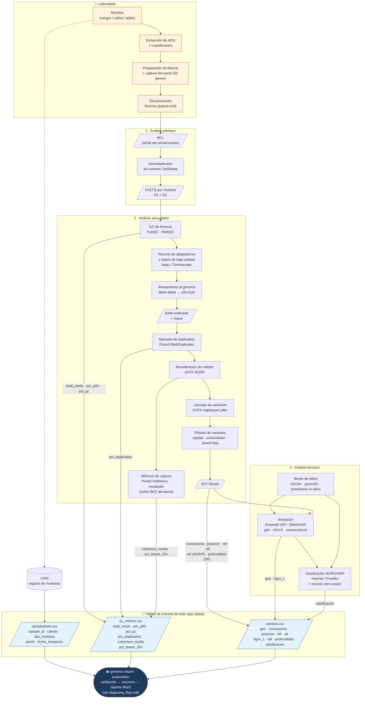

# Diagrama del pipeline bioinformático (aguas arriba)

Este repositorio **no** procesa lecturas: parte de tres tablas ya generadas. El diagrama muestra el pipeline
bioinformático típico de un **panel de genes por captura (germinal, short-read Illumina)** que produce esas
tablas, y de qué paso sale cada columna que luego valida `config/rules.yaml`.

> Las herramientas indicadas son las de uso habitual (GATK Best Practices). Cada laboratorio puede usar
> equivalentes (DRAGEN, DeepVariant, ANNOVAR, etc.); lo importante es que la salida tenga las mismas columnas.

## De dónde sale cada métrica que valida el repo

| Columna | Paso / herramienta | Qué indica | Umbral en `rules.yaml` |
|---|---|---|---|
| `total_reads` | FastQC / demultiplexado | Lecturas totales de la muestra | fail < 1 M · warn < 2 M |
| `pct_q30` | FastQC / bcl-convert | % de bases con calidad Phred ≥ 30 (error ≤ 0,1 %) | fail < 75 · warn < 85 |
| `pct_gc` | FastQC | Contenido GC; fuera de rango sugiere contaminación o sesgo de captura | warn fuera de 35–55 |
| `pct_duplicados` | Picard MarkDuplicates | Lecturas PCR/ópticas duplicadas; alto = baja complejidad de librería | fail > 40 · warn > 30 |
| `cobertura_media` | Picard HsMetrics / mosdepth | Profundidad media sobre las regiones del panel | fail < 100x · warn < 150x |
| `pct_bases_20x` | Picard HsMetrics / mosdepth | % de bases objetivo con ≥ 20x (uniformidad) | fail < 90 · warn < 95 |
| `profundidad` | VCF (campo `DP`) | Lecturas que cubren la variante | warn < 20 |
| `vaf` | VCF (`AD` alt / `DP`) | Fracción alélica; ~0,5 heterocigota, ~1 homocigota | error fuera de [0, 1] |
| `gen`, `hgvs_c` | VEP / ANNOVAR | Gen y nomenclatura HGVS de la variante | — |
| `clasificacion` | ACMG/AMP + curador | Benigna … Patogénica | debe ser categoría ACMG |
