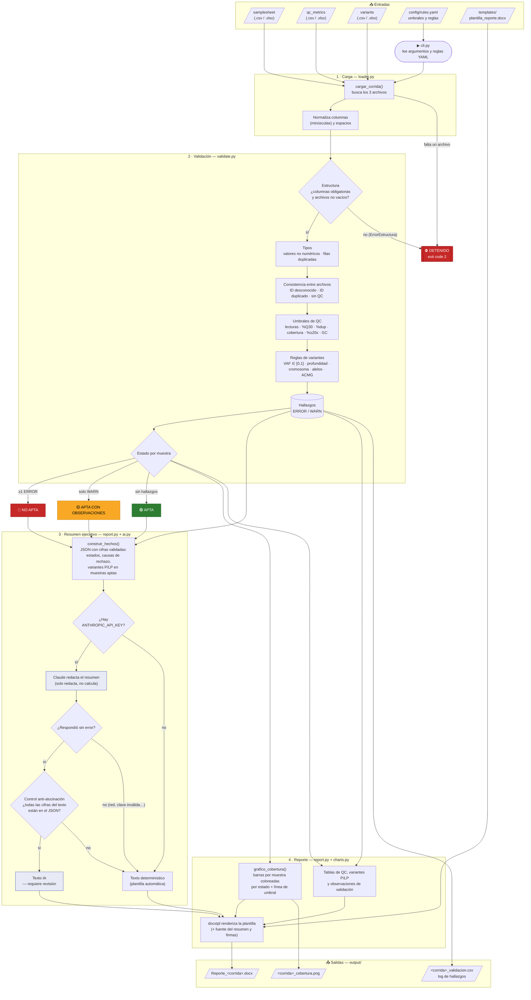

# Diagrama de flujo del pipeline

Flujo completo de `python -m reportgen.cli <carpeta> --corrida <ID>`, desde los archivos de entrada hasta el reporte Word.
GitHub dibuja el diagrama automáticamente (Mermaid).

## Cómo leerlo

| Etapa | Módulo | Qué hace | Si falla |
|---|---|---|---|
| 1. Carga | `loader.py` | Lee los 3 archivos (CSV o Excel) y normaliza columnas | Falta un archivo → **se detiene** |
| 2. Validación | `validate.py` | Estructura → tipos → consistencia → QC → variantes | Falla de estructura → **se detiene**; el resto se registra como hallazgo |
| Estado | `validate.py` | ERROR → NO APTA · solo WARN → APTA CON OBS. · nada → APTA | — |
| 3. Resumen | `report.py`, `ai.py` | Claude redacta a partir de cifras ya validadas | Sin clave, error de API o cifra inventada → texto determinístico |
| 4. Reporte | `report.py`, `charts.py` | Llena la plantilla Word con tablas, gráfico y firmas | — |

Los umbrales del paso 2 se configuran en [`config/rules.yaml`](../config/rules.yaml).
